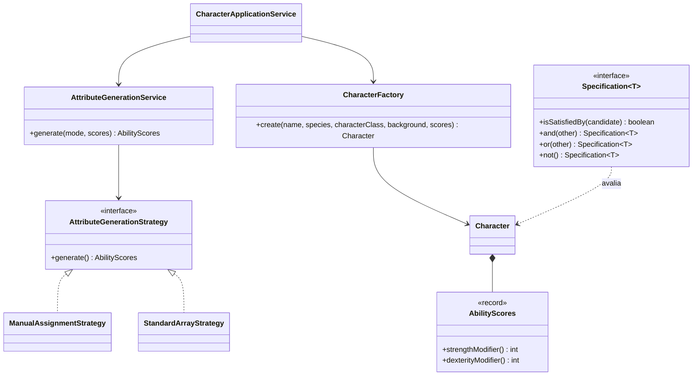

[](https://canva.link/6mm47lyq3l0dg60)

# D&D Character Forge

[](https://github.com/Vitor-C-Souza/dnd-character-forge/actions/workflows/ci.yml)


**API REST para criação e gerenciamento de fichas de personagens de D&D 5e (2024), desenvolvida com Java 21 e Spring
Boot.**

O projeto tem como objetivo aplicar modelagem de domínio rica, Design Patterns, persistência relacional com
versionamento de schema e testes automatizados em incrementos revisáveis.

> Projeto de estudo e portfólio, sem afiliação oficial aos titulares de Dungeons & Dragons. As regras de D&D 5e (2024)
> são implementadas de forma gradual e autenticação/autorização ainda não fazem parte do escopo atual.

## Navegação

[Estado atual](#estado-atual) · [Stack](#stack) · [Arquitetura e Padrões](#arquitetura-e-padrões) · [Endpoints da API](#endpoints-da-api) · [Executar localmente](#executar-localmente) · [Testes e qualidade](#testes-e-qualidade) · [Estratégia de branches](#estratégia-de-branches) · [Autor](#autor)

## Estado atual

| Componente                    | Implementação                                                                                                                                                                                        |
|:------------------------------|:-----------------------------------------------------------------------------------------------------------------------------------------------------------------------------------------------------|
| **Atributos e Modificadores** | `AbilityScores`: record imutável (`@Embeddable`) validando pontuações entre `1` e `30`, com cálculo de modificadores (`Math.floorDiv(score - 10, 2)`) para todos os 6 atributos                      |
| **Bônus de Proficiência**     | `ProficiencyBonus`: cálculo estático baseado no nível do personagem (`1` a `20`), seguindo a progressão `2 + (level - 1) / 4`                                                                        |
| **Entidade Personagem**       | Entidade JPA `Character` herdando `BaseEntity` (UUID, auditoria de timestamps, `@Version` para optimistic locking e exclusão lógica com `@SQLDelete` / `@SQLRestriction`)                            |
| **Strategy & Selector**       | `AttributeGenerationStrategy` (`ManualAssignmentStrategy` e `StandardArrayStrategy`) orquestrada pelo seletor `AttributeGenerationService` via `AttributeGenerationMode`                             |
| **Factory**                   | `CharacterFactory`: encapsula a instanciação validada de `Character` na camada de serviço                                                                                                            |
| **Specification**             | Interface funcional `Specification<T>` com composição booleana (`and`, `or`, `not`) e regras de domínio (`CharacterClassSpecification`, `MinimumLevelSpecification`, `MinimumStrengthSpecification`) |
| **API REST e Exceções**       | `CharacterController` (`/api/v1/characters`), DTOs de entrada/saída e `GlobalExceptionHandler` padronizado com RFC 7807 (`ProblemDetail`)                                                            |
| **Persistência e Infra**      | MySQL 8.4, Flyway (`V1__CREATE_TABLE.sql`), Dockerfile multi-stage e Docker Compose com health checks                                                                                                |
| **Qualidade e CI**            | Testes unitários (JUnit 5/Mockito) e integração real com MySQL (Surefire/Failsafe), JaCoCo e pipeline GitHub Actions + SonarCloud                                                                    |

## Stack

| Área                    | Tecnologias                                                                |
|:------------------------|:---------------------------------------------------------------------------|
| **Linguagem e Build**   | Java 21, Maven 3.9+                                                        |
| **Framework**           | Spring Boot 3.5.7 (Spring Web, Bean Validation, Spring Data JPA, Actuator) |
| **Banco e Migrations**  | MySQL 8.4, Flyway                                                          |
| **Documentação HTTP**   | Springdoc OpenAPI 2.8.13 (Swagger UI)                                      |
| **Testes**              | JUnit 5, Mockito, AssertJ, Spring Boot Test (unitários e integração `*IT`) |
| **Infraestrutura e CI** | Docker, Docker Compose, GitHub Actions, JaCoCo 0.8.13, SonarCloud          |

## Arquitetura e Padrões

A estrutura separa explicitamente domínio, aplicação, persistência e camada web:

```text
src/main/java/com/vitorcsouza/app/characterforge/
├── config/            # Configuração do OpenAPI / Swagger
├── controller/        # Endpoints REST (/api/v1/characters)
├── domain/
│   ├── model/         # Entidades (Character, BaseEntity), Value Objects (AbilityScores), Enums e regras (ProficiencyBonus)
│   └── specification/ # Padrão Specification composicional (and, or, not)
├── dto/               # Contratos de request e response da API
├── exception/         # Tratamento global de erros com ProblemDetail (RFC 7807)
├── repository/        # Repositórios Spring Data JPA
└── service/
    ├── strategy/      # Estratégias de geração de atributos (Manual e Standard Array)
    ├── AttributeGenerationService.java  # Strategy Selector
    ├── CharacterApplicationService.java # Orquestração de casos de uso
    └── CharacterFactory.java            # Factory de criação de personagens

```



### Exemplo de uso no código

> **Nota:** O construtor padrão sem argumentos de `Character` é `protected` por exigência da especificação JPA, portanto
> `new Character()` não deve ser utilizado diretamente. Utilize `CharacterFactory` ou o construtor completo de domínio.

```java
import com.vitorcsouza.app.characterforge.domain.model.AbilityScores;
import com.vitorcsouza.app.characterforge.domain.model.Character;
import com.vitorcsouza.app.characterforge.domain.model.CharacterBackground;
import com.vitorcsouza.app.characterforge.domain.model.CharacterClass;
import com.vitorcsouza.app.characterforge.domain.model.CharacterSpecies;
import com.vitorcsouza.app.characterforge.domain.model.ProficiencyBonus;
import com.vitorcsouza.app.characterforge.domain.specification.CharacterClassSpecification;
import com.vitorcsouza.app.characterforge.domain.specification.MinimumStrengthSpecification;
import com.vitorcsouza.app.characterforge.domain.specification.Specification;
import com.vitorcsouza.app.characterforge.service.AttributeGenerationService;
import com.vitorcsouza.app.characterforge.service.CharacterFactory;
import com.vitorcsouza.app.characterforge.service.strategy.AttributeGenerationMode;

// 1. Seleção e validação de atributos via Strategy Selector
AttributeGenerationService generationService = new AttributeGenerationService();
        AbilityScores rawScores = new AbilityScores(15, 14, 13, 12, 10, 8);
        AbilityScores validatedScores = generationService.generate(AttributeGenerationMode.STANDARD_ARRAY, rawScores);

        // 2. Criação do personagem via Factory
        CharacterFactory factory = new CharacterFactory();
        Character character = factory.create(
                "Thorin Escudo de Carvalho",
                CharacterSpecies.DWARF,
                CharacterClass.FIGHTER,
                CharacterBackground.SOLDIER,
                validatedScores
        );

        // 3. Cálculo de modificadores e bônus de proficiência
        int strModifier = character.getAbilityScores().strengthModifier(); // +2
        int profBonus = ProficiencyBonus.calculate(character.getLevel());     // +2 (nível 1)

        // 4. Avaliação de regras combinadas com Specification
        Specification<Character> heavyArmorEligible =
                new CharacterClassSpecification(CharacterClass.FIGHTER, CharacterClass.PALADIN)
                        .and(new MinimumStrengthSpecification(13));

        boolean isEligible = heavyArmorEligible.isSatisfiedBy(character); // true

```

## Endpoints da API

| Método   | Rota                                     | Descrição                                                             |
|----------|------------------------------------------|-----------------------------------------------------------------------|
| `POST`   | `/api/v1/characters`                     | Cria um novo personagem aplicando a estratégia de atributos escolhida |
| `GET`    | `/api/v1/characters`                     | Lista os personagens ativos (não excluídos logicamente)               |
| `GET`    | `/api/v1/characters/{id}`                | Busca um personagem ativo por UUID                                    |
| `PATCH`  | `/api/v1/characters/{id}/ability-scores` | Atualiza os atributos de um personagem existente                      |
| `DELETE` | `/api/v1/characters/{id}`                | Realiza a exclusão lógica (soft delete) do personagem                 |

## Executar localmente

### Requisitos

* Git
* JDK 21 e Maven 3.9+ (para execução local pela IDE ou terminal)
* Docker Engine / Docker Desktop com Docker Compose v2

### 1. Clonar e configurar variáveis de ambiente

```bash
git clone --branch development [https://github.com/Vitor-C-Souza/dnd-character-forge.git](https://github.com/Vitor-C-Souza/dnd-character-forge.git)
cd dnd-character-forge
cp .env.example .env

```

Ajuste as credenciais locais no arquivo `.env` (nunca versione este arquivo).

### 2. Executar aplicação e banco via Docker Compose

```bash
docker compose up --build -d
docker compose ps
docker compose logs -f app

```

O serviço `app` aguarda o health check do `mysql` ficar saudável, executa as migrations do Flyway e valida o schema JPA.
Os dados ficam persistidos no volume `mysql_data`.

Para encerrar mantendo os dados:

```bash
docker compose down

```

Para encerrar e apagar o volume do banco local:

```bash
docker compose down -v

```

### 3. Alternativa: executar aplicação pela IDE ou Maven

1. Suba apenas o banco de dados MySQL via Docker Compose:

```bash
docker compose up -d mysql

```

2. Configure as variáveis de ambiente na sua IDE ou terminal (conforme documentado em `.env.example`):

* `DB_URL=jdbc:mysql://localhost:3306/characterforge?useSSL=false&allowPublicKeyRetrieval=true&serverTimezone=UTC`
* `DB_USERNAME=characterforge`
* `DB_PASSWORD=<mesma_senha_definida_em_MYSQL_PASSWORD>`
* `SERVER_PORT=8080` (opcional)


3. Execute os testes ou inicie a aplicação:

```bash
mvn clean verify
mvn spring-boot:run

```

### Endereços locais

| Recurso             | URL                                       |
|---------------------|-------------------------------------------|
| **API Base**        | `http://localhost:8080/api/v1/characters` |
| **Swagger UI**      | `http://localhost:8080/swagger-ui.html`   |
| **OpenAPI JSON**    | `http://localhost:8080/api-docs`          |
| **Actuator Health** | `http://localhost:8080/actuator/health`   |

## Testes e qualidade

A suíte é dividida entre testes unitários (`*Test.java`, executados pelo Maven Surefire) e testes de integração contra
MySQL (`*IT.java`, executados pelo Maven Failsafe):

```bash
mvn clean verify

```

> **Requisito para testes de integração (`*IT`):** Como `application-test.yml` valida o schema real com Flyway e MySQL,
> certifique-se de que uma instância MySQL esteja acessível (via `docker compose up -d mysql` ou serviço local
> compatível
> com `DB_URL`).

* **Relatórios de testes:** `target/surefire-reports/` e `target/failsafe-reports/`
* **Relatório de cobertura JaCoCo:** `target/site/jacoco/index.html` e `target/site/jacoco/jacoco.xml`
* **Cobertura medida (`jacoco.csv`):** **95,95%** de instruções (1.138/1.186), **90,38%** de branches (47/52),
  **95,49%** de linhas (233/244) e **90,28%** de métodos (65/72).

### Pipeline CI e SonarCloud

O workflow `.github/workflows/ci.yml` sobe um serviço MySQL 8.4, executa `mvn clean verify` e publica os relatórios como
artefatos por 7 dias.

A etapa `SonarCloud analysis` é condicionada às variáveis do repositório no GitHub (**Settings → Secrets and variables →
Actions**):

| Tipo                 | Nome                 | Finalidade                          |
|----------------------|----------------------|-------------------------------------|
| **Actions variable** | `SONAR_ORGANIZATION` | Chave da organização no SonarCloud  |
| **Actions variable** | `SONAR_PROJECT_KEY`  | Chave do projeto no SonarCloud      |
| **Actions secret**   | `SONAR_TOKEN`        | Token de autenticação do SonarCloud |

Enquanto `SONAR_ORGANIZATION` e `SONAR_PROJECT_KEY` não estiverem configuradas no repositório, o job
`SonarCloud analysis` é ignorado (`skipped`) intencionalmente sem bloquear o build. Quando configuradas, o pipeline
executa a análise e aguarda o Quality Gate (`-Dsonar.qualitygate.wait=true`).

## Estratégia de branches

* `main`: branch estável de produção/release (protegida).
* `development`: branch de integração das entregas concluídas.
* `feature/<nome>`, `fix/<nome>`, `docs/<nome>`, `test/<nome>`: branches de trabalho criadas a partir de `development` e
  integradas via Pull Request após aprovação do CI.

## Autor

**Vítor Cavalcante
Souza** · [GitHub](https://github.com/Vitor-C-Souza) · [LinkedIn](https://www.linkedin.com/in/vitorcavalcantesouza/)