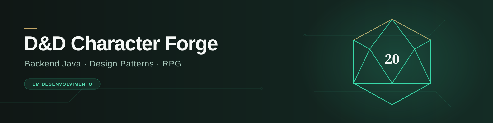
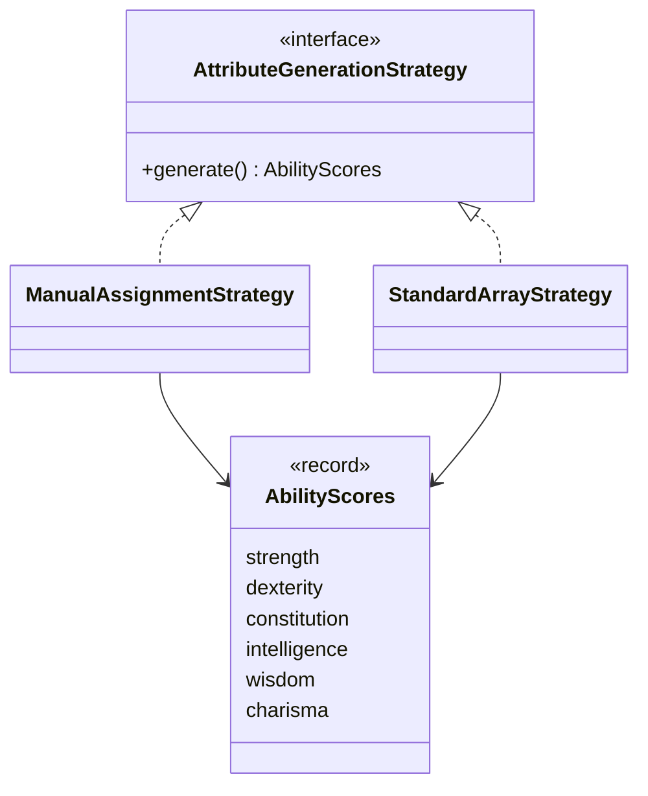

[](https://canva.link/6mm47lyq3l0dg60)

# D&D Character Forge

[](https://github.com/Vitor-C-Souza/dnd-character-forge/actions/workflows/ci.yml)


**Um laboratório de backend Java com temática de RPG, construído para evoluir em uma API de criação e gerenciamento de personagens de D&D 5e (2024).**

O objetivo é praticar modelagem de domínio, Design Patterns, persistência e testes em incrementos pequenos e revisáveis.

> Esta documentação descreve a branch `development`. O projeto está em desenvolvimento: ainda não há controllers de personagens, CRUD HTTP ou autenticação implementados nesta branch. Não é uma implementação completa das regras de D&D.

## Navegação

[Estado atual](#estado-atual) · [Stack](#stack) · [Arquitetura](#arquitetura) · [Executar](#executar) · [Testes e qualidade](#testes-e-qualidade) · [Roadmap](#roadmap)

## Estado atual

| Componente | Implementação |
| --- | --- |
| Atributos | `AbilityScores`: record imutável com força, destreza, constituição, inteligência, sabedoria e carisma; valida valores entre 1 e 30 |
| Personagem | Entidade JPA `Character`, com atualização conjunta dos atributos por `updateAbilityScores` |
| Strategy | Interface `AttributeGenerationStrategy` com método `generate()` |
| Atribuição manual | `ManualAssignmentStrategy` recebe um `AbilityScores` não nulo e o devolve |
| Standard Array | `StandardArrayStrategy` valida uma distribuição contendo exatamente 15, 14, 13, 12, 10 e 8, em qualquer ordem |
| Persistência | `CharacterRepository` e migration Flyway para a tabela `tb_characters` |
| Infraestrutura | MySQL 8.4, Dockerfile em múltiplos estágios e Docker Compose com health checks |
| Qualidade | Testes de atributos e estratégias, teste de contexto, JaCoCo e workflow de CI |

As estratégias atuais **recebem distribuições prontas**: não sorteiam atributos nem implementam compra de pontos. O intervalo de 1 a 30 representa a validação atual do value object, sem garantir todas as restrições de criação de personagem.

## Stack

| Área | Tecnologias |
| --- | --- |
| Linguagem e build | Java 21, Maven |
| Aplicação | Spring Boot 3.5.7, Spring Web, Bean Validation, Actuator |
| Persistência | Spring Data JPA, MySQL, Flyway |
| Documentação HTTP | Springdoc OpenAPI 2.8.13 |
| Testes | Spring Boot Test, JUnit, H2 |
| Entrega e qualidade | Docker Compose, GitHub Actions, JaCoCo 0.8.13, configuração SonarCloud |

## Arquitetura

A estrutura atual separa modelo, repositório e estratégias. As estratégias não dependem de HTTP; a entidade `Character` utiliza anotações JPA.



A interface permite que diferentes regras de atribuição compartilhem o mesmo contrato. Um fluxo de criação de personagem que selecione e utilize essas estratégias ainda precisa ser integrado nesta branch.

### Exemplo de uso no código

```java
AbilityScores distribution = new AbilityScores(15, 14, 13, 12, 10, 8);
AttributeGenerationStrategy strategy = new StandardArrayStrategy(distribution);
AbilityScores result = strategy.generate();

Character character = new Character();
character.updateAbilityScores(result);
```

Importe as classes de `domain.model` e `service.strategy`; use um import explícito para a entidade `Character`, distinguindo-a de `java.lang.Character`. O exemplo ilustra o domínio, não uma chamada HTTP nem uma persistência completa.

## Executar

### Requisitos

- Git;
- JDK 21 e Maven 3.9+ para execução pela máquina;
- Docker com Compose v2 para banco e/ou aplicação em contêiner.

### 1. Obter a branch documentada

```bash
git clone --branch development https://github.com/Vitor-C-Souza/dnd-character-forge.git
cd dnd-character-forge
```

### 2. Configurar o ambiente

O `.env.example` atual ainda contém variáveis `POSTGRES_*` antigas. Para o Compose atual, crie um arquivo `.env` na raiz com as variáveis MySQL abaixo e ajuste as senhas:

```dotenv
MYSQL_DATABASE=characterforge
MYSQL_USER=characterforge
MYSQL_PASSWORD=change-me-local-only
MYSQL_ROOT_PASSWORD=change-me-root-local-only
MYSQL_PORT=3306
APP_PORT=8080
```

Esses valores são exemplos locais. Não versione o `.env` nem reutilize essas senhas em ambientes compartilhados.

### 3. Subir aplicação e banco

```bash
docker compose up --build -d
docker compose ps
docker compose logs -f app
```

O serviço `app` aguarda o health check do serviço `mysql`. O Flyway cria o schema versionado e o Hibernate valida o mapeamento. Os dados persistem no volume `mysql_data`.

Para encerrar mantendo o volume:

```bash
docker compose down
```

### Alternativa: aplicação pela IDE/Maven

```bash
docker compose up -d mysql
mvn clean verify
mvn spring-boot:run
```

Antes de iniciar pelo Maven ou IDE, configure as variáveis de ambiente do processo:

| Variável | Valor local / finalidade |
| --- | --- |
| `DB_URL` | `jdbc:mysql://localhost:3306/characterforge` — ajuste porta e banco conforme o Compose |
| `DB_USERNAME` | Mesmo valor de `MYSQL_USER` |
| `DB_PASSWORD` | Mesmo valor de `MYSQL_PASSWORD` |
| `SERVER_PORT` | Opcional; padrão `8080` |

O arquivo `.env` é lido pelo Docker Compose; a execução Maven/IDE **não o carrega automaticamente**. `APP_PORT` altera a porta publicada do contêiner; `SERVER_PORT` configura a aplicação executada fora dele.

### Endereços locais

Considerando a porta padrão 8080:

| Recurso | Endereço configurado |
| --- | --- |
| Saúde | http://localhost:8080/actuator/health |
| Swagger UI | http://localhost:8080/swagger-ui.html |
| OpenAPI JSON | http://localhost:8080/api-docs |

O Springdoc está configurado, mas ainda não existem operações de personagens para demonstrar na documentação HTTP. As URLs acima refletem a configuração; não representam validação de uma instância em execução.

## Testes e qualidade

```bash
mvn clean verify
```

Os testes usam H2 com perfil de teste e dispensam MySQL externo. A suíte inclui validações de `AbilityScores`, atribuição manual, Standard Array e inicialização do contexto. H2 não substitui uma verificação de integração contra o MySQL real.

- Relatório de testes: `target/surefire-reports/`.
- Cobertura HTML: `target/site/jacoco/index.html`.
- Cobertura XML: `target/site/jacoco/jacoco.xml`.

O workflow executa build/testes em pushes para `main`, `development`, `feature/**`, `fix/**` e `test/**`, além de PRs para `main` e `development`. Os relatórios são publicados como artefatos por sete dias.

A análise SonarCloud depende destas configurações no GitHub:

| Tipo | Nome |
| --- | --- |
| Actions variable | `SONAR_ORGANIZATION` |
| Actions variable | `SONAR_PROJECT_KEY` |
| Actions secret | `SONAR_TOKEN` |

O job é condicionado às duas variables e aguarda o Quality Gate. Esta documentação não afirma um percentual de cobertura nem um resultado atual do SonarCloud.

## Roadmap

- [x] Modelar atributos como value object.
- [x] Implementar atribuição manual e validação de Standard Array.
- [x] Criar entidade, repositório e migration inicial.
- [x] Configurar testes, relatórios, CI e infraestrutura Docker.
- [ ] Integrar seleção das estratégias ao caso de uso de criação.
- [ ] Implementar DTOs, serviços de aplicação e endpoints de personagens.
- [ ] Adicionar testes de integração com MySQL.
- [ ] Evoluir regras de criação com referências compatíveis com D&D 5e (2024).
- [ ] Introduzir autenticação e autorização em uma etapa futura.

O roadmap indica próximos passos e não uma promessa de prazo. Features em branches separadas só devem ser consideradas parte desta base após integração.

## Contribuição

Crie sua branch a partir de `development`, faça uma alteração focada, execute `mvn clean verify` e abra um Pull Request para `development`. Utilize o template de PR e documente mudanças de comportamento. A promoção para `main` deve acontecer após revisão e validação.

## Autor

**Vítor Cavalcante Souza** · [GitHub](https://github.com/Vitor-C-Souza) · [LinkedIn](https://www.linkedin.com/in/vitorcavalcantesouza/)

Projeto independente de estudo e portfólio, sem afiliação oficial aos titulares de Dungeons & Dragons.
