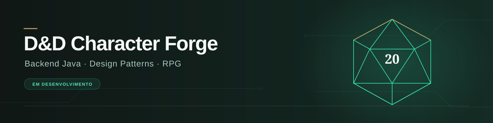
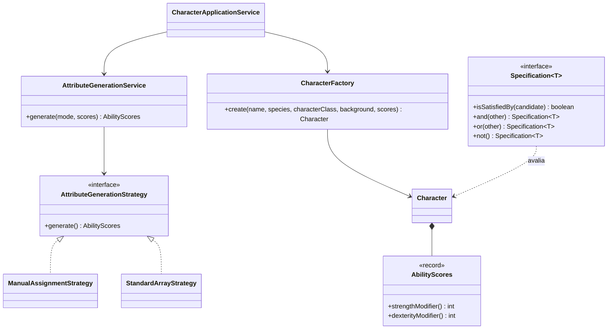

<p align="center">
  
</p>

<p align="center">
  <strong>API REST para criação e gerenciamento de fichas de personagens de D&amp;D 5e (2024), construída com Java 21 e Spring Boot.</strong>
</p>

<p align="center">
  <a href="https://github.com/Vitor-C-Souza/dnd-character-forge/actions/workflows/ci.yml"></a>
  
  
  
</p>

> Projeto de estudo e portfólio, sem afiliação oficial aos titulares de Dungeons & Dragons. As regras de D&D 5e (2024)
> são implementadas de forma gradual, e autenticação/autorização ainda não fazem parte do escopo atual.

## Sobre o projeto

O D&D Character Forge aplica **modelagem de domínio rica**, **Design Patterns**, **persistência relacional com
versionamento de schema** e **testes automatizados**, tudo entregue em incrementos pequenos e revisáveis por Pull Request.

## Navegação

[Estado atual](#estado-atual) · [Stack](#stack) · [Arquitetura e padrões](#arquitetura-e-padrões) · [Endpoints](#endpoints-da-api) · [Executar localmente](#executar-localmente) · [Testes e qualidade](#testes-e-qualidade) · [Branches](#estratégia-de-branches) · [Autor](#autor)

## Estado atual

| Componente                    | Implementação                                                                                                                                                                                       |
|-------------------------------|-----------------------------------------------------------------------------------------------------------------------------------------------------------------------------------------------------|
| **Atributos e modificadores** | `AbilityScores`: record imutável (`@Embeddable`) que valida pontuações entre `1` e `30` e calcula os modificadores (`Math.floorDiv(score - 10, 2)`) dos 6 atributos                                  |
| **Bônus de proficiência**     | `ProficiencyBonus`: cálculo estático por nível (`1` a `20`), seguindo a progressão `2 + (level - 1) / 4`                                                                                            |
| **Entidade Personagem**       | Entidade JPA `Character` que herda de `BaseEntity` (UUID, auditoria de timestamps, `@Version` para optimistic locking e exclusão lógica com `@SQLDelete` / `@SQLRestriction`)                       |
| **Strategy e Selector**       | `AttributeGenerationStrategy` (`ManualAssignmentStrategy` e `StandardArrayStrategy`), escolhida pelo `AttributeGenerationService` via `AttributeGenerationMode`                                     |
| **Factory**                   | `CharacterFactory`: encapsula a criação validada de `Character` na camada de serviço                                                                                                                |
| **Specification**             | Interface funcional `Specification<T>` com composição booleana (`and`, `or`, `not`) e regras de domínio (`CharacterClassSpecification`, `MinimumLevelSpecification`, `MinimumStrengthSpecification`) |
| **API REST e exceções**       | `CharacterController` (`/api/v1/characters`), DTOs de entrada/saída e `GlobalExceptionHandler` padronizado com RFC 7807 (`ProblemDetail`)                                                           |
| **Persistência e infra**      | MySQL 8.4, Flyway (`V1__CREATE_TABLE.sql`), Dockerfile multi-stage e Docker Compose com health checks                                                                                              |
| **Qualidade e CI**            | Testes unitários (JUnit 5/Mockito) e de integração com MySQL real (Surefire/Failsafe), JaCoCo e pipeline GitHub Actions + SonarCloud                                                                |

## Stack

| Área                    | Tecnologias                                                                |
|-------------------------|----------------------------------------------------------------------------|
| **Linguagem e build**   | Java 21, Maven 3.9+                                                        |
| **Framework**           | Spring Boot 3.5.7 (Spring Web, Bean Validation, Spring Data JPA, Actuator) |
| **Banco e migrations**  | MySQL 8.4, Flyway                                                          |
| **Documentação HTTP**   | Springdoc OpenAPI 2.8.13 (Swagger UI)                                      |
| **Testes**              | JUnit 5, Mockito, AssertJ, Spring Boot Test, Testcontainers (`*Test` e `*IT`) |
| **Infraestrutura e CI** | Docker, Docker Compose, GitHub Actions, JaCoCo 0.8.13, SonarCloud          |

## Arquitetura e padrões

A estrutura separa explicitamente domínio, aplicação, persistência e camada web:

```text
src/main/java/com/vitorcsouza/app/characterforge/
├── config/            # Configuração do OpenAPI / Swagger
├── controller/        # Endpoints REST (/api/v1/characters)
├── domain/
│   ├── model/         # Entidades (Character, BaseEntity), value objects (AbilityScores), enums e regras (ProficiencyBonus)
│   └── specification/ # Padrão Specification composicional (and, or, not)
├── dto/               # Contratos de request e response da API
├── exception/         # Tratamento global de erros com ProblemDetail (RFC 7807)
├── repository/        # Repositórios Spring Data JPA
└── service/
    ├── strategy/                        # Estratégias de geração de atributos (Manual e Standard Array)
    ├── AttributeGenerationService.java  # Strategy Selector
    ├── CharacterApplicationService.java # Orquestração dos casos de uso
    └── CharacterFactory.java            # Factory de criação de personagens
```



### Exemplo de uso no código

> **Nota:** o construtor sem argumentos de `Character` é `protected` por exigência da especificação JPA, então
> `new Character()` não deve ser usado diretamente. Use `CharacterFactory` ou o construtor completo de domínio.

```java
import com.vitorcsouza.app.characterforge.domain.model.AbilityScores;
import com.vitorcsouza.app.characterforge.domain.model.Character;
import com.vitorcsouza.app.characterforge.domain.model.CharacterBackground;
import com.vitorcsouza.app.characterforge.domain.model.CharacterClass;
import com.vitorcsouza.app.characterforge.domain.model.CharacterSpecies;
import com.vitorcsouza.app.characterforge.domain.model.ProficiencyBonus;
import com.vitorcsouza.app.characterforge.domain.specification.CharacterClassSpecification;
import com.vitorcsouza.app.characterforge.domain.specification.MinimumStrengthSpecification;
import com.vitorcsouza.app.characterforge.domain.specification.Specification;
import com.vitorcsouza.app.characterforge.service.AttributeGenerationService;
import com.vitorcsouza.app.characterforge.service.CharacterFactory;
import com.vitorcsouza.app.characterforge.service.strategy.AttributeGenerationMode;

// 1. Seleção e validação de atributos via Strategy Selector
AttributeGenerationService generationService = new AttributeGenerationService();
AbilityScores rawScores = new AbilityScores(15, 14, 13, 12, 10, 8);
AbilityScores validatedScores = generationService.generate(AttributeGenerationMode.STANDARD_ARRAY, rawScores);

// 2. Criação do personagem via Factory
CharacterFactory factory = new CharacterFactory();
Character character = factory.create(
        "Thorin Escudo de Carvalho",
        CharacterSpecies.DWARF,
        CharacterClass.FIGHTER,
        CharacterBackground.SOLDIER,
        validatedScores
);

// 3. Modificadores e bônus de proficiência
int strModifier = character.getAbilityScores().strengthModifier(); // +2
int profBonus = ProficiencyBonus.calculate(character.getLevel());  // +2 (nível 1)

// 4. Regras combinadas com Specification
Specification<Character> heavyArmorEligible =
        new CharacterClassSpecification(CharacterClass.FIGHTER, CharacterClass.PALADIN)
                .and(new MinimumStrengthSpecification(13));

boolean isEligible = heavyArmorEligible.isSatisfiedBy(character); // true
```

## Endpoints da API

| Método   | Rota                                     | Descrição                                                             |
|----------|------------------------------------------|-----------------------------------------------------------------------|
| `POST`   | `/api/v1/characters`                     | Cria um personagem aplicando a estratégia de atributos escolhida      |
| `GET`    | `/api/v1/characters`                     | Lista os personagens ativos (não excluídos logicamente)               |
| `GET`    | `/api/v1/characters/{id}`                | Busca um personagem ativo por UUID                                    |
| `PATCH`  | `/api/v1/characters/{id}/ability-scores` | Atualiza os atributos de um personagem existente                      |
| `DELETE` | `/api/v1/characters/{id}`                | Realiza a exclusão lógica (soft delete) do personagem                 |

A documentação interativa fica disponível no Swagger UI (veja [Endereços locais](#endereços-locais)).

## Executar localmente

### Requisitos

* Git
* JDK 21 e Maven 3.9+ (para executar pela IDE ou pelo terminal)
* Docker Engine / Docker Desktop com Docker Compose v2

### 1. Clonar e configurar as variáveis de ambiente

```bash
git clone --branch development https://github.com/Vitor-C-Souza/dnd-character-forge.git
cd dnd-character-forge
cp .env.example .env
```

Ajuste as credenciais locais no arquivo `.env` (nunca versione este arquivo).

### 2. Subir aplicação e banco com Docker Compose

```bash
docker compose up --build -d
docker compose ps
docker compose logs -f app
```

O serviço `app` espera o health check do `mysql`, executa as migrations do Flyway e valida o schema JPA. Os dados ficam
persistidos no volume `mysql_data`.

Para encerrar mantendo os dados:

```bash
docker compose down
```

Para encerrar e apagar o volume do banco local:

```bash
docker compose down -v
```

### 3. Executar a aplicação pela IDE ou pelo Maven

Para iniciar a aplicação fora do Docker Compose, disponibilize um MySQL 8.4 acessível. Se quiser usar o banco definido no Compose do projeto, suba somente o serviço `mysql`:

```bash
docker compose up -d mysql
```

Configure as variáveis de ambiente na IDE ou no terminal (conforme `.env.example`):

* `DB_URL=jdbc:mysql://localhost:3306/characterforge?useSSL=false&allowPublicKeyRetrieval=true&serverTimezone=UTC`
* `DB_USERNAME=characterforge`
* `DB_PASSWORD=<mesma_senha_definida_em_MYSQL_PASSWORD>`
* `SERVER_PORT=8080` (opcional)

Inicie a aplicação:

```bash
mvn spring-boot:run
```

### 4. Executar os testes

Execute a suíte completa com:

```bash
mvn clean verify
```

Os testes de integração que estendem `AbstractIntegrationTest` — incluindo `CharacterForgeApplicationTest` e os testes `*IT.java` executados pelo Maven Failsafe — usam **Testcontainers** para iniciar automaticamente um container efêmero do MySQL 8.4 (`mysql:8.4`). Os demais testes unitários não dependem de um banco MySQL externo. Portanto, para executar a suíte completa, basta manter o Docker Engine / Docker Desktop em execução: **não é necessário subir previamente o serviço MySQL do Compose nem configurar um banco externo**.

### Endereços locais

| Recurso             | URL                                       |
|---------------------|-------------------------------------------|
| **API base**        | `http://localhost:8080/api/v1/characters` |
| **Swagger UI**      | `http://localhost:8080/swagger-ui.html`   |
| **OpenAPI JSON**    | `http://localhost:8080/api-docs`          |
| **Actuator health** | `http://localhost:8080/actuator/health`   |

## Testes e qualidade

A suíte se divide em testes unitários (`*Test.java`, via Maven Surefire) e testes de integração isolados (`*IT.java`,
via Maven Failsafe):

```bash
mvn clean verify
```

* **Testcontainers:** os testes de integração sobem um container efêmero do MySQL 8.4 (`mysql:8.4`) automaticamente.
  O **Docker Desktop** precisa estar rodando ao executá-los.
* **Relatórios de testes:** `target/surefire-reports/` e `target/failsafe-reports/`
* **Cobertura (JaCoCo):** `target/site/jacoco/index.html` e `target/site/jacoco/jacoco.xml`

### Pipeline de CI e SonarCloud

O workflow `.github/workflows/ci.yml` executa `mvn clean verify` e publica os relatórios como artefatos por 7 dias. Como
os testes de integração usam Testcontainers, o pipeline não precisa de um serviço MySQL externo no GitHub Actions.

A etapa `SonarCloud analysis` depende das configurações do repositório
(**Settings → Secrets and variables → Actions**):

| Tipo                 | Nome                 | Finalidade                          |
|----------------------|----------------------|-------------------------------------|
| **Actions variable** | `SONAR_ORGANIZATION` | Chave da organização no SonarCloud  |
| **Actions variable** | `SONAR_PROJECT_KEY`  | Chave do projeto no SonarCloud      |
| **Actions secret**   | `SONAR_TOKEN`        | Token de autenticação do SonarCloud |

Enquanto `SONAR_ORGANIZATION` e `SONAR_PROJECT_KEY` não estiverem configuradas, o job `SonarCloud analysis` é ignorado
(`skipped`) de propósito, sem bloquear o build. Quando configuradas, o pipeline roda a análise e aguarda o Quality Gate
(`-Dsonar.qualitygate.wait=true`).

## Estratégia de branches

* `main`: branch estável de produção/release (protegida).
* `development`: branch de integração das entregas concluídas.
* `feature/<nome>`, `fix/<nome>`, `docs/<nome>`, `test/<nome>`: branches de trabalho criadas a partir de `development` e
  integradas via Pull Request após aprovação do CI.

## Autor

**Vítor Cavalcante Souza** · [GitHub](https://github.com/Vitor-C-Souza) · [LinkedIn](https://www.linkedin.com/in/vitorcavalcantesouza/)
